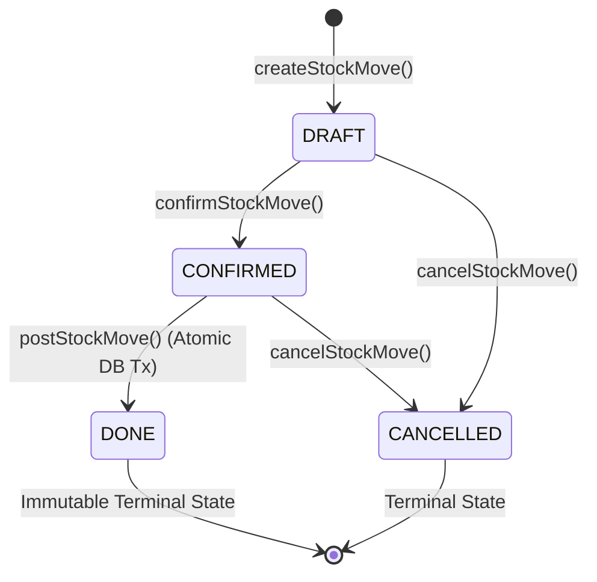

# Domain Architecture & Business Rules: The Stock Ledger

## 1. Executive Summary & Problem Context

In traditional naive inventory systems, stock is represented as a single mutable numeric column on a product table (e.g. `products.stock_quantity = 31`). When discrepancies occur—for instance, when a retail store starts with 40 bags of rice, the database shows 31, but the physical shelf only contains 27—the business owner has no means to determine **when** the variance occurred, **which** transaction caused it, or **who** authorized the adjustment.

**Techvisk P02: Inventory I — The Stock Ledger** implements an auditable, enterprise-grade inventory engine inspired by Odoo's double-entry stock movement architecture. Every inventory change is recorded as an immutable stock move transferring items from a source location to a destination location.

---

## 2. Core Domain Principles & Invariants

The engine strictly enforces eight core architectural rules:

1. **Auditable Movement Ledger**:
   - Stock quantities never change arbitrarily. Every inventory adjustment corresponds to an explicit record in `inv_stock_moves`.
   - Inventory changes are modeled as vector transfers: $(source \rightarrow destination, quantity)$.

2. **Strict Inward / Outward Typing**:
   - A stock movement transfers a strictly positive quantity ($quantity > 0$) between two distinct locations ($source\_location\_id \neq destination\_location\_id$).

3. **Lifecycle State Machine**:
   - Only movements in the `DONE` state affect inventory. Draft or confirmed movements reserve or track intention, but never alter physical stock on hand.

4. **Zero Negative Stock Invariance**:
   - At real, physical inventory locations (`INTERNAL`), available stock can never drop below zero:
     $$\text{Available Stock} = \text{Quantity On Hand} - \text{Reserved Quantity} \ge 0$$
   - Any transaction attempting to overdraw source inventory is rejected atomically at the database level.

5. **Atomic Transactional Posting**:
   - Posting a movement updates both source and destination locations within a single PostgreSQL transaction (`SERIALIZABLE` or pessimistic row locking via `SELECT ... FOR UPDATE`).
   - If either side of the transfer fails, the entire transaction rolls back completely.

6. **Immutability of Completed Movements**:
   - Once a movement reaches the `DONE` state, it is strictly immutable. It cannot be edited, cancelled, or re-posted.
   - Any physical correction requires a compensating movement (e.g. an `ADJUSTMENT` or `RETURN` move).

7. **Idempotency Under Concurrent Contention**:
   - Duplicate or retried requests to post the same movement ID must not duplicate inventory deductions. Re-executing a completed move returns the existing `DONE` record without re-updating quants.

8. **Conservation of Inventory Mass**:
   - In any closed transfer between internal warehouse locations:
     $$\Delta Q_{\text{source}} + \Delta Q_{\text{destination}} = -Q + Q = 0$$
   - The total warehouse stock across all internal zones remains constant.

---

## 3. Location Taxonomy & Quant Semantics

Locations in the system are categorized by strict domain types:

| Location Type | Physical / Virtual | Inventory Semantics | Quant Tracking Policy |
| :--- | :--- | :--- | :--- |
| **`INTERNAL`** | Physical | Real warehouse racks, bins, shelves, receiving docks. Stock must be $\ge 0$. | Tracked in `inv_stock_quants`. Deductions require sufficient balance. |
| **`SUPPLIER`** | Virtual | External vendor partners. Source of inward `GRN` goods. | Virtual infinite supply. No negative check enforced; quants not decremented. |
| **`CUSTOMER`** | Virtual | External buyers. Destination of outbound `SALE` goods. | Virtual consumption sink. Quants not accumulated in merchant stock-on-hand. |
| **`LOSS`** | Virtual | Shrinkage, expiration, or discrepancy write-off sink. | Virtual counterparty for inventory adjustments downwards. |
| **`SCRAP`** | Virtual | Damaged or defective write-off location. | Virtual destination for scrapped goods. |
| **`TRANSIT`** | Virtual / Inter-WH | Intermediate holding for cross-warehouse movements. | Used to balance inter-warehouse transfers in multi-facility operations. |

---

## 4. Movement State Machine

### State Definitions:
- **`DRAFT`**: Proposed movement. Editable. Has no effect on physical stock.
- **`CONFIRMED`**: Verified operation waiting for warehouse execution. Cannot be posted until confirmed.
- **`DONE`**: Executed and committed. Atomically updates `inv_stock_quants` and sets `done_date = NOW()`. Strictly immutable.
- **`CANCELLED`**: Revoked move. Terminal. Cannot be confirmed or posted.

---

## 5. Dual-Layer Storage Architecture: Quants vs Ledger

The engine balances **auditability** and **query performance** using two complementary layers:

1. **`inv_stock_moves` (The Authoritative Ledger)**:
   - Append-only event history.
   - Records who, when, why, and how many items moved.
   - Grows to millions of rows over time.

2. **`inv_stock_quants` (The Performance Snapshot Table)**:
   - Fast cache of current stock balances by `(product_id, variant_id, location_id, lot_id)`.
   - Bounded in size to $O(\text{products} \times \text{locations})$.
   - Powers sub-millisecond stock-on-hand lookups.

3. **Reconciliation Guarantee**:
   - The reconciliation engine regularly verifies that for every physical location $L$:
     $$\text{Quant Quantity}(P, L) = \sum_{M \in \text{DONE}, \text{dest}=L} M.\text{qty} - \sum_{M \in \text{DONE}, \text{src}=L} M.\text{qty}$$
   - Any difference indicates mathematical drift and is flagged immediately for audit.
