# System Architecture & Workflow Diagrams: Inventory II

This document compiles the authoritative visual architecture and process diagrams for **Cora ERP — Inventory II (P03)** for FreshMart. All diagrams are committed as raw Markdown using standard Mermaid syntax.

---

## 1. System Context Diagram (C4 Level 1)

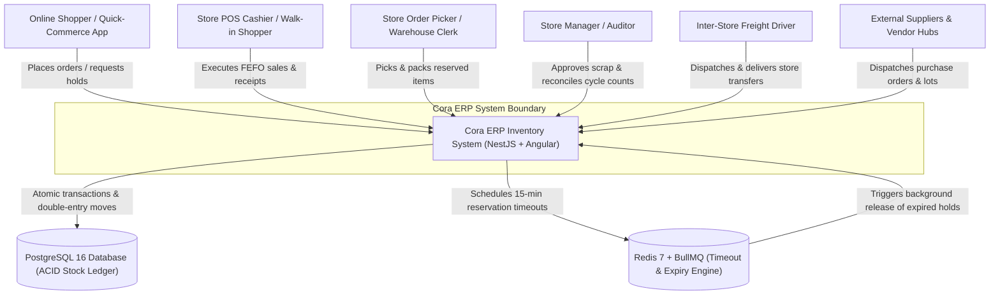

---

## 2. Component Diagram (C4 Level 2)

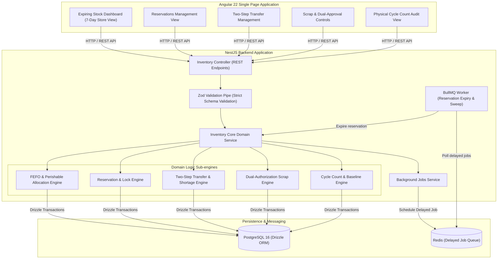

---

## 3. Entity-Relationship Diagram (Complete Database Schema)

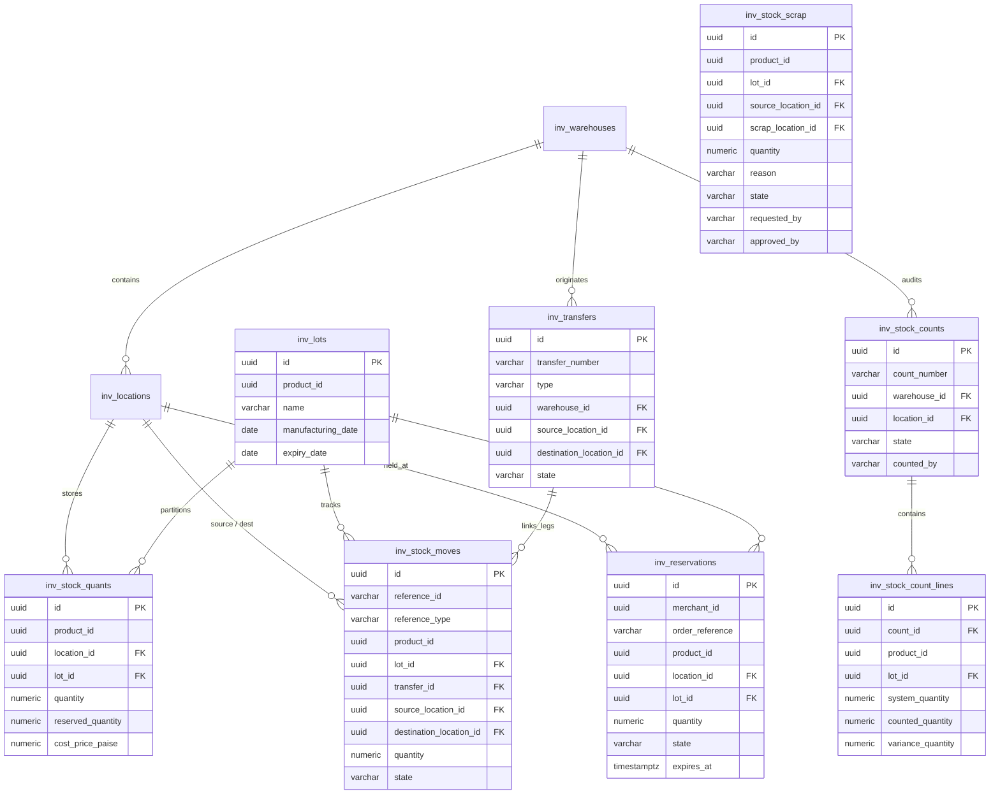

---

## 4. State Machine: Transfer Lifecycle

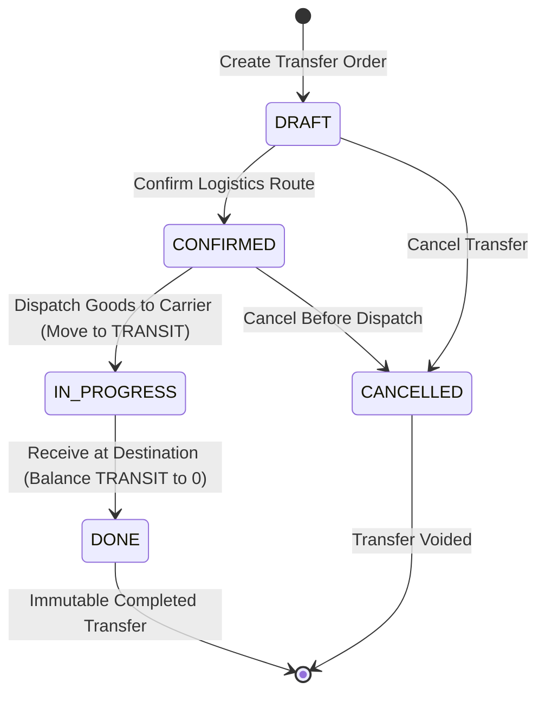

---

## 5. State Machine: Reservation Lifecycle

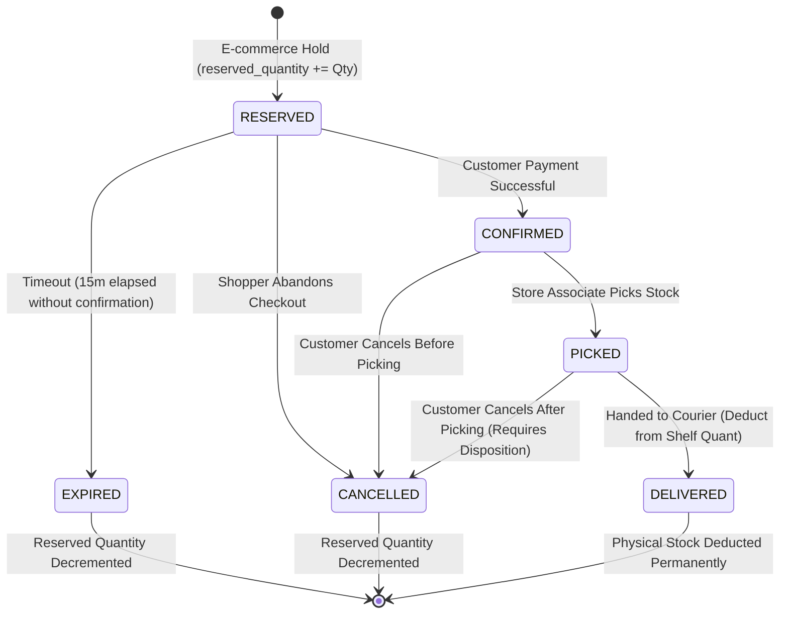

---

## 6. Sequence Diagram: Two-Step Inter-Store Transfer

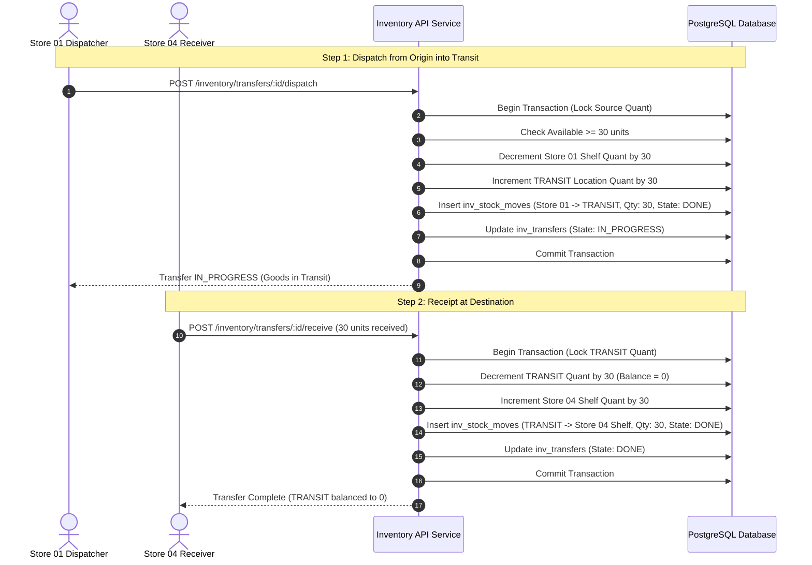

---

## 7. Sequence Diagram: Transfer with Shortage (30 Dispatched, 28 Received)

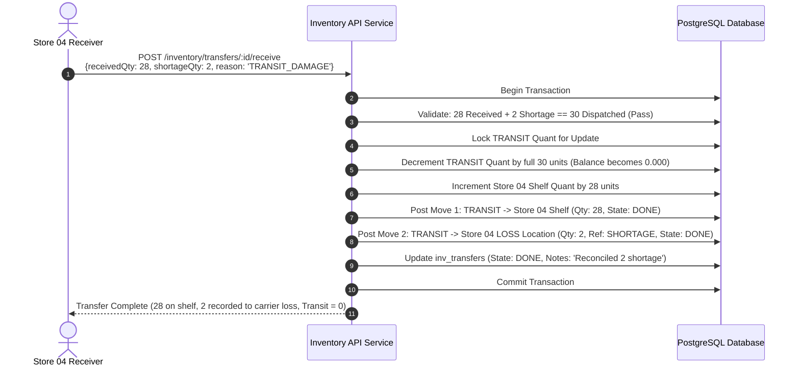

---

## 8. Sequence Diagram: Reserve -> Pick -> Deliver

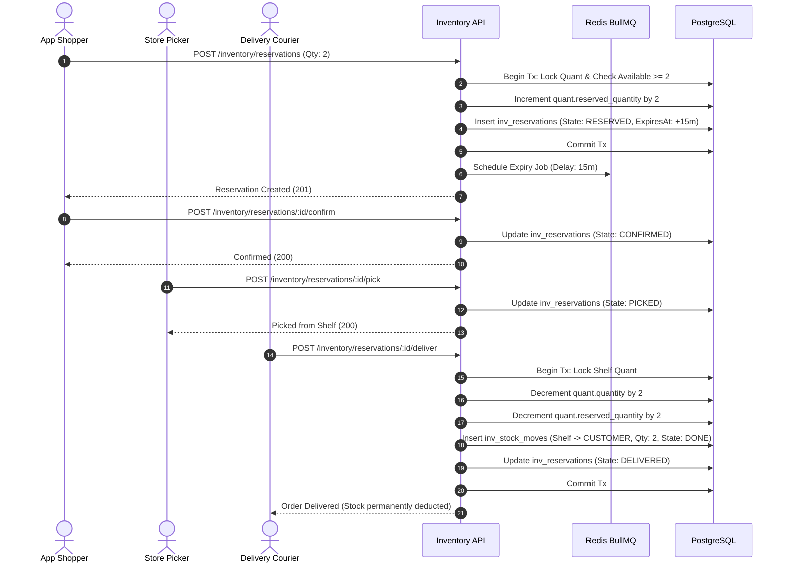

---

## 9. Sequence Diagram: Customer Cancellation After Picking

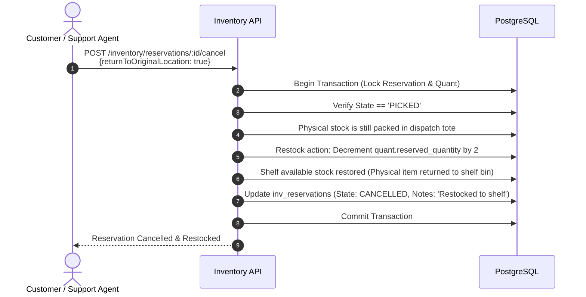

---

## 10. Sequence Diagram: Reservation Timeout vs Concurrent Confirmation

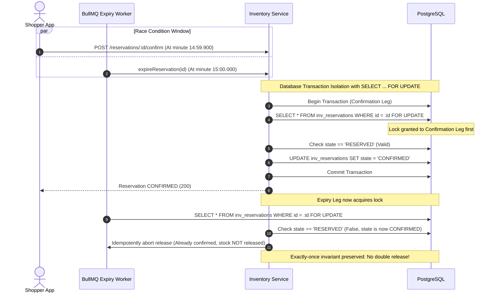

---

## 11. Sequence Diagram: Physical Count with Active Store Operations

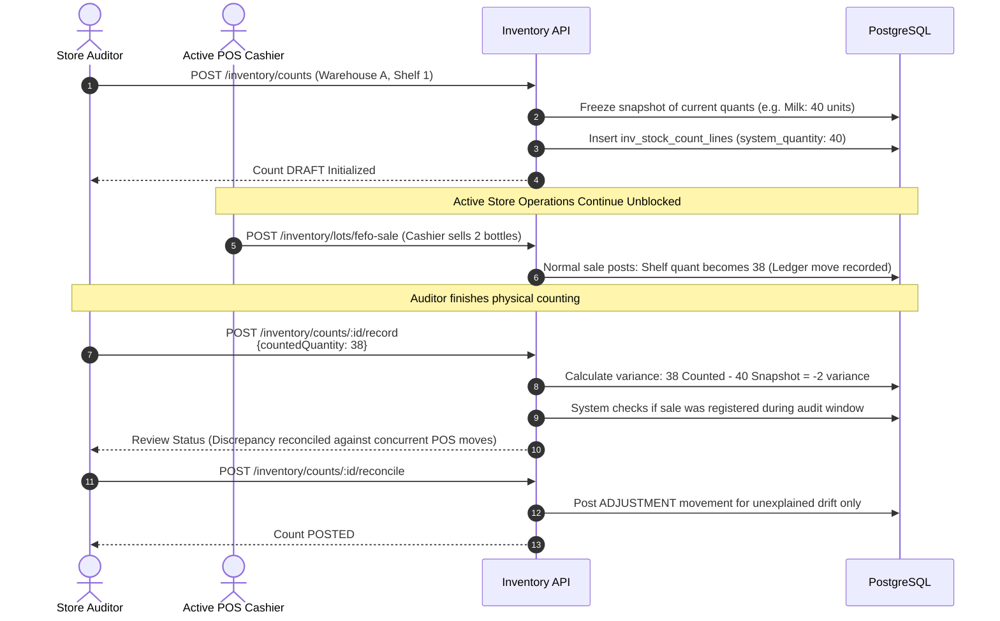

---

## 12. Sequence Diagram: Scrap Request & Independent Dual-Approval

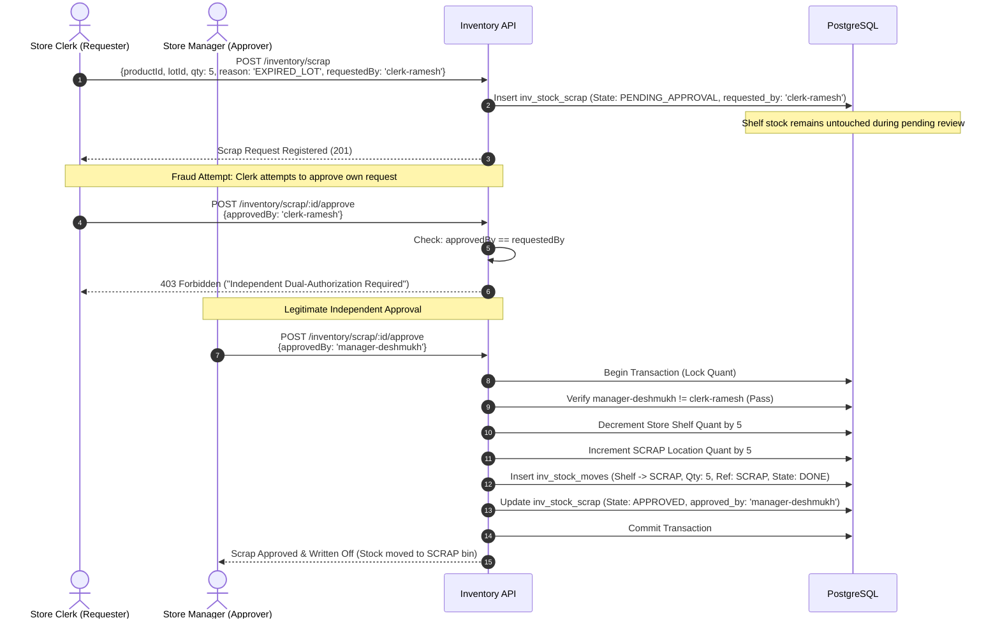

---

## 13. 7-Day 4-Line Inventory Trajectory Graph

The diagram below illustrates the mathematical conservation of inventory across a 7-day period for a perishable product experiencing receipts, customer reservations, store transfers, and sales:

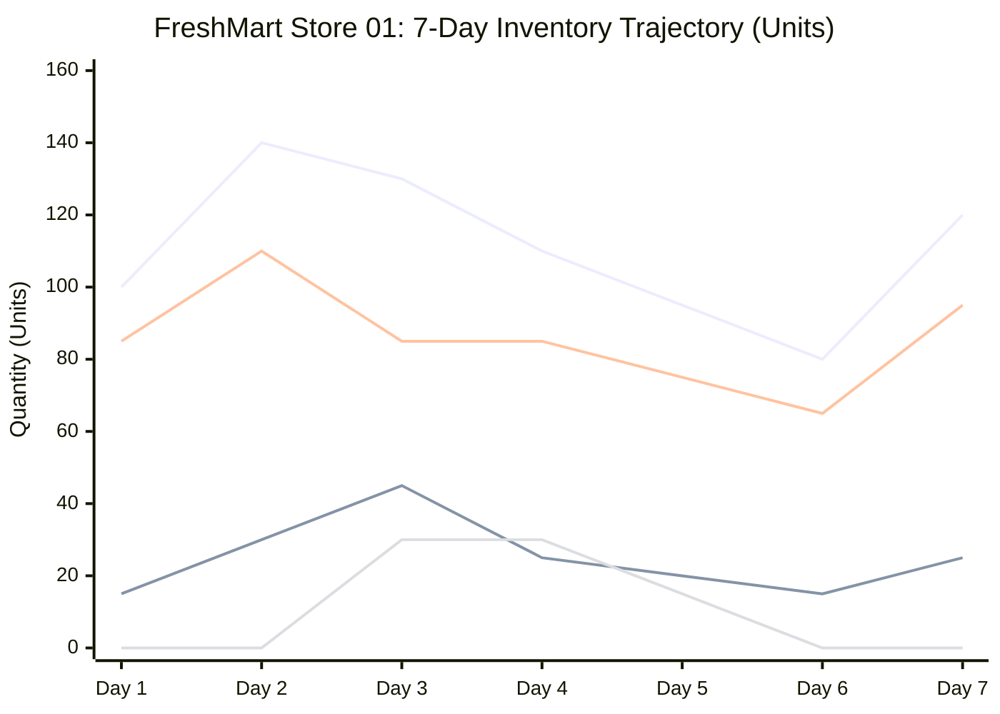

### Legend & Curve Relationships:
1. **Line 1 (Blue — On-Hand Stock):** Total physical inventory present in store. Increases on Day 2 upon supplier GRN (+40 units), decreases as items are delivered or transferred.
2. **Line 2 (Orange — Reserved Stock):** Items held for online cart checkouts. Spikes on Days 2–3 during peak e-commerce promotions.
3. **Line 3 (Green — Available Stock):** Strictly adheres to the fundamental invariant:
   $$\text{Available} = \text{On-Hand} - \text{Reserved}$$
   Represents sellable stock for walk-in shoppers and new digital cart allocations.
4. **Line 4 (Purple — In-Transit Stock):** 30 units dispatched on Day 3 towards Store 04. Disappears on Day 6 once Store 04 completes physical goods receipt. Notice that transit inventory is never counted in either store's available curve!
