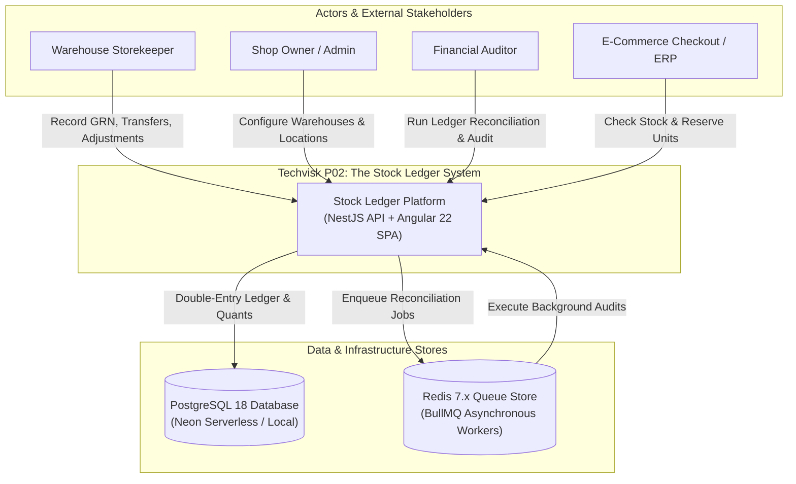
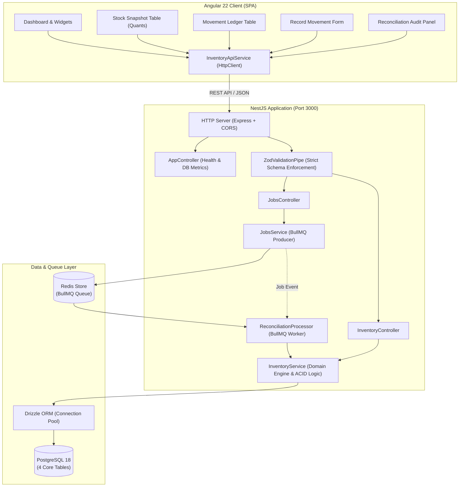
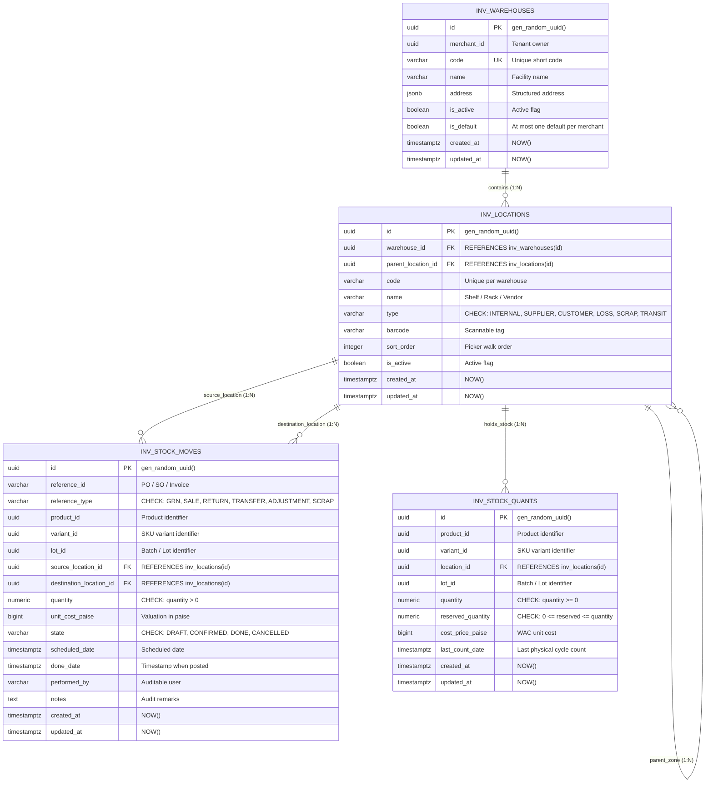
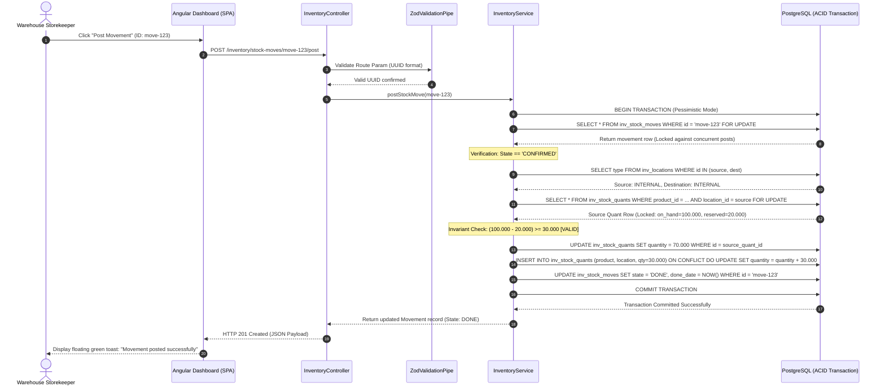
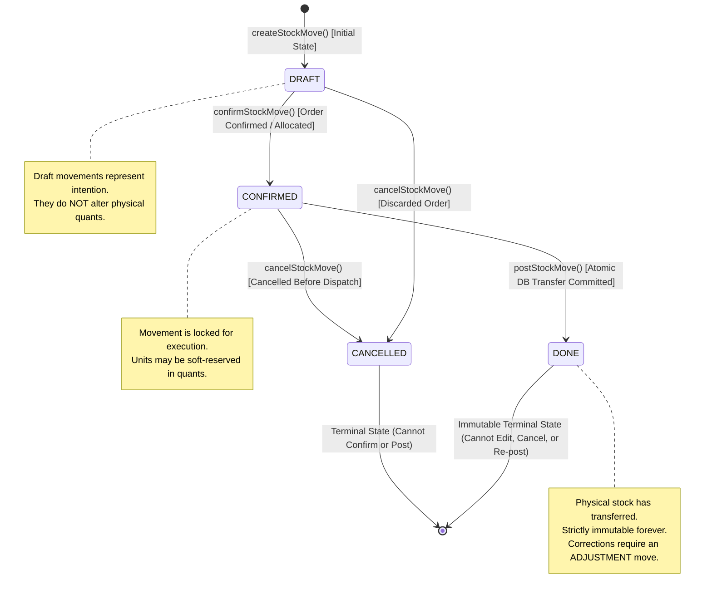
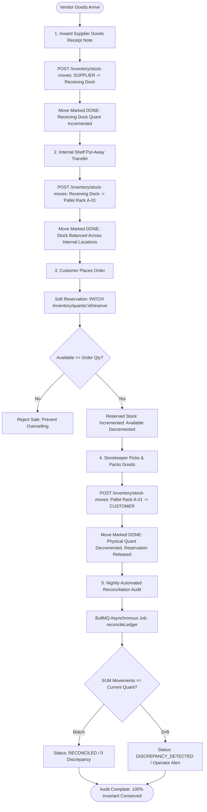

# System Architecture & Technical Diagrams — P02 Stock Ledger

This document contains seven architectural diagrams modeling the verified implementation of **The Stock Ledger**.

---

## 1. System Context Diagram (C4 Level 1)



---

## 2. Component Diagram (C4 Level 2)



---

## 3. Entity-Relationship Diagram (ERD)



---

## 4. Successful Stock Movement Sequence Diagram



---

## 5. Failure-Midway Sequence Diagram (Overdraft / DB Disconnect)

```mermaid
sequenceDiagram
    autonumber
    actor Cashier as Cashier / API Client
    participant Ctrl as InventoryController
    participant Srv as InventoryService
    participant DB as PostgreSQL Transaction

    Cashier->>Ctrl: POST /inventory/stock-moves/sale-999/post (Request 50 units)
    Ctrl->>Srv: postStockMove(sale-999)
    Srv->>DB: BEGIN TRANSACTION
    Srv->>DB: SELECT * FROM inv_stock_moves WHERE id = 'sale-999' FOR UPDATE
    DB-->>Srv: Move Locked (Qty: 50.000, Source: Shelf A-01)

    Srv->>DB: SELECT * FROM inv_stock_quants WHERE location_id = 'Shelf A-01' FOR UPDATE
    DB-->>Srv: Quant Locked (Quantity: 30.000, Reserved: 0.000)

    Note over Srv: Invariant Failure: Requested (50) > Available (30)
    
    critical Atomic Rollback on Rule Violation
        Srv->>DB: ROLLBACK TRANSACTION
        DB-->>Srv: Transaction Aborted cleanly
    end

    Note over DB: Guaranteed State: Source Quant remains 30.000; Move remains CONFIRMED; Zero Partial Updates!
    
    Srv-->>Ctrl: Throw BadRequestException ("Insufficient stock: available is 30.000, requested 50.000")
    Ctrl-->>Cashier: HTTP 400 Bad Request { error: "Insufficient stock...", status: 400 }
```

---

## 6. State Machine Diagram: Movement Lifecycle (`inv_stock_moves.state`)



---

## 7. End-to-End Business Process Flow Diagram


