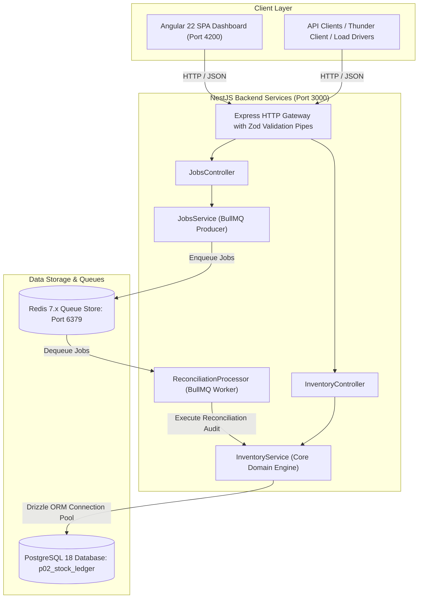
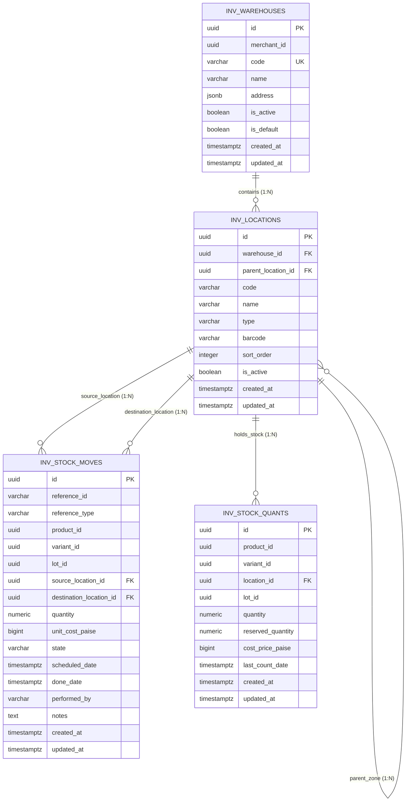
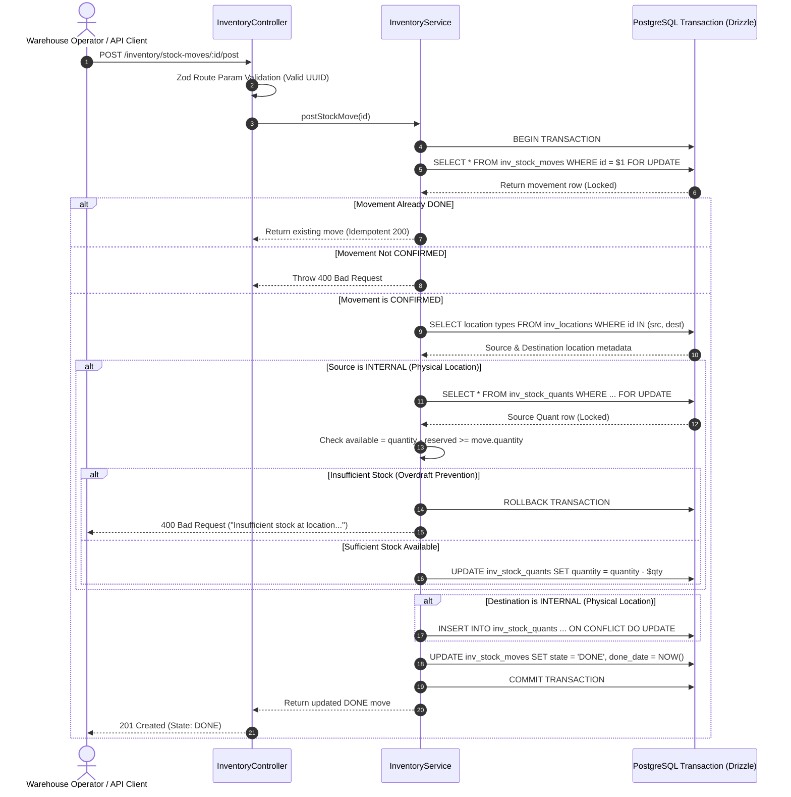
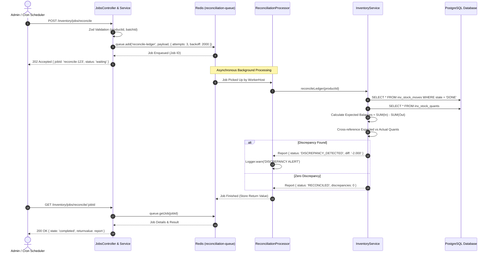

# System Architecture & Technical Diagrams

## 1. High-Level System Architecture

---

## 2. Entity-Relationship Diagram (ERD)

---

## 3. Movement Posting Sequence & Transaction Boundary

---

## 4. Background Ledger Reconciliation Workflow (BullMQ)

